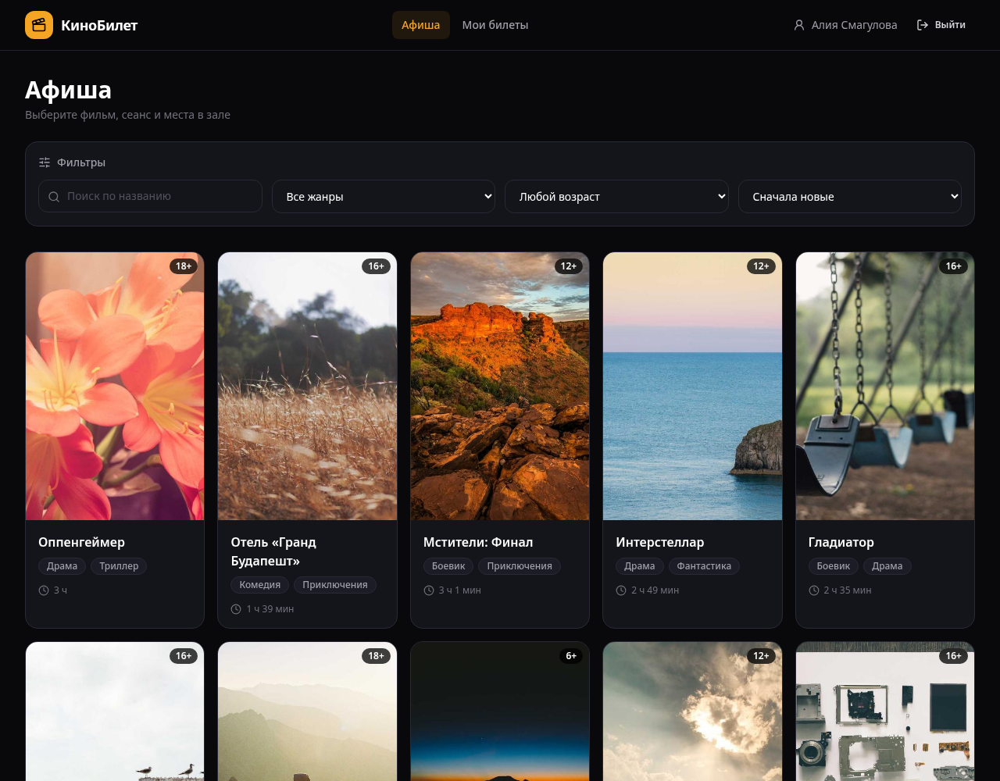
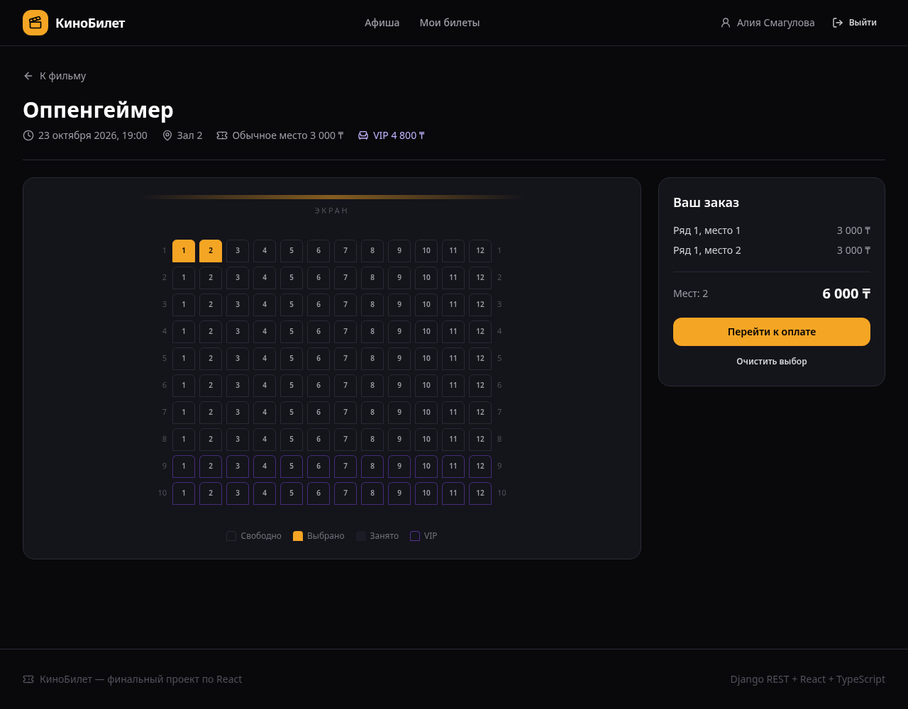
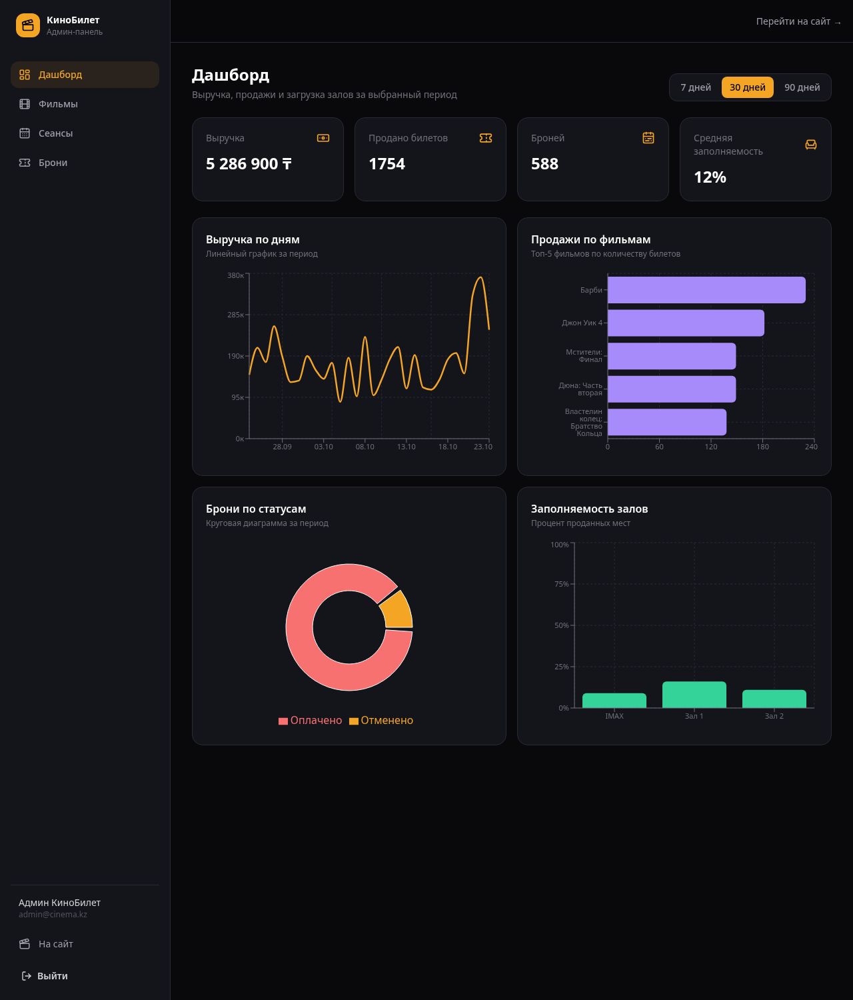
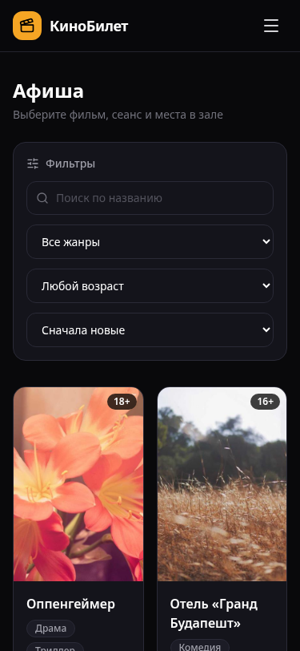

# КиноБилет — сервис бронирования билетов в кино

Финальный full-stack проект: афиша фильмов, выбор сеанса и мест в зале, оплата
(демонстрационная), электронные билеты и админ-панель с аналитикой.

- **Тема:** №4 — бронирование билетов в кино
- **Роли:** зритель (`viewer`) и администратор (`admin`)
- **Валюта:** тенге (₸), интерфейс на русском языке

## Скриншоты

| Афиша | Выбор мест |
|---|---|
|  |  |

| Дашборд администратора | Мобильная версия (375px) |
|---|---|
|  |  |

## Стек

| Слой | Технологии |
|---|---|
| Frontend | React 19, TypeScript, Vite, Tailwind CSS 4, React Router 7 |
| Состояние | Redux Toolkit, TanStack Query |
| Формы и валидация | React Hook Form, Zod |
| HTTP | Axios (`baseURL` из `.env`, interceptors для JWT) |
| Графики | Recharts |
| UI-библиотеки | lucide-react, Sonner, dayjs |
| Backend | Django 6, Django REST Framework, SimpleJWT, django-filter, SQLite |

## Возможности

**Зритель**

- регистрация и вход по email (JWT: access + refresh);
- афиша с поиском, фильтрами по жанру и возрасту, сортировкой и пагинацией;
- карточка фильма с будущими сеансами;
- интерактивная схема зала: обычные и VIP-места, занятые места;
- оформление заказа с валидацией данных и демонстрационной оплатой;
- список своих билетов, фильтр по статусу, отмена брони с подтверждением;
- профиль пользователя.

**Администратор**

- дашборд: выручка по дням, топ фильмов, брони по статусам, заполняемость залов;
- полный CRUD фильмов;
- создание, редактирование и удаление сеансов;
- просмотр всех броней, поиск и отмена брони.

**Технические требования**

- защищённые маршруты и проверка роли на фронтенде и бэкенде;
- автоматическое обновление access-токена при ответе 401;
- при неудачном refresh — очистка токенов и редирект на `/login`;
- состояния загрузки, ошибки и пустых списков на всех страницах;
- фильтры, поиск и пагинация хранятся в URL (`useSearchParams`);
- адаптивность на 375 / 768 / 1280 px, бургер-меню на мобильных;
- атомарное бронирование: уникальность места на сеанс на уровне БД.

## Структура проекта

```
frontend/
  src/
    api/          # Axios-клиент и функции запросов
    components/   # UI-компоненты и layout'ы
    features/     # карточки фильмов, схема зала, авторизация
    hooks/        # useAuth, useDebounce, useDisclosure, хуки запросов
    lib/          # токены, даты, ошибки, утилиты
    pages/        # страницы приложения и админки
    schemas/      # Zod-схемы форм
    store/        # Redux Toolkit: auth, booking, ui
    types/        # TypeScript-типы
backend/
  cinema/
    management/commands/seed_demo.py  # демо-данные
    models.py                         # фильмы, залы, сеансы, брони, билеты
    serializers.py                    # DRF-сериализаторы
    views.py                          # API и дашборд
    permissions.py                    # роли и права
    pagination.py                     # пагинация с page_size
  config/                             # настройки Django
docs/                                 # задание и скриншоты
```

## Запуск

Требования: Python 3.12+ (проверено на 3.14), Node.js 20+ (проверено на 22).

### 1. Бэкенд

```bash
cd backend
python3 -m venv .venv
source .venv/bin/activate
pip install -r requirements.txt

cp .env.example .env        # можно оставить значения по умолчанию
python manage.py migrate
python manage.py seed_demo  # демо-данные: 15 фильмов, 3 зала, 540 сеансов, 700 броней
python manage.py runserver
```

API будет доступен на `http://127.0.0.1:8000/api/`.
Админка Django — `http://127.0.0.1:8000/admin/`.

### 2. Фронтенд

```bash
cd frontend
cp .env.example .env        # VITE_API_URL=http://127.0.0.1:8000/api
npm install
npm run dev
```

Приложение откроется на `http://127.0.0.1:5173/`.

### Переменные окружения

`backend/.env`:

| Переменная | Назначение |
|---|---|
| `DJANGO_SECRET_KEY` | секретный ключ Django |
| `DJANGO_DEBUG` | `True` / `False` |
| `DJANGO_ALLOWED_HOSTS` | список хостов через запятую |
| `CORS_ALLOWED_ORIGINS` | origins фронтенда |
| `CSRF_TRUSTED_ORIGINS` | доверенные origins для admin/HTTPS |

`frontend/.env`:

| Переменная | Назначение |
|---|---|
| `VITE_API_URL` | базовый URL API, например `http://127.0.0.1:8000/api` |

## Тестовые аккаунты

| Роль | Email | Пароль |
|---|---|---|
| Администратор | `admin@cinema.kz` | `Admin123!` |
| Зритель | `user@cinema.kz` | `User123!` |
| Зритель | `anna@cinema.kz` | `User123!` |

## Маршруты фронтенда

| Путь | Доступ | Описание |
|---|---|---|
| `/` | все | редирект на афишу |
| `/movies` | все | афиша, поиск, фильтры, пагинация |
| `/movies/:id` | все | карточка фильма и сеансы |
| `/login`, `/register` | гости | вход и регистрация |
| `/sessions/:id/seats` | авторизованные | выбор мест |
| `/checkout` | авторизованные | оформление и оплата |
| `/my/tickets` | авторизованные | мои брони |
| `/profile` | авторизованные | профиль |
| `/admin` | админ | дашборд с графиками |
| `/admin/movies` | админ | список фильмов |
| `/admin/movies/new` | админ | создание фильма |
| `/admin/movies/:id/edit` | админ | редактирование фильма |
| `/admin/sessions` | админ | список сеансов |
| `/admin/sessions/new` | админ | создание сеанса |
| `/admin/sessions/:id/edit` | админ | редактирование сеанса |
| `/admin/bookings` | админ | все брони |
| `/403` | все | нет доступа |
| `*` | все | страница 404 |

## API

| Метод | Endpoint | Описание |
|---|---|---|
| `POST` | `/api/auth/register/` | регистрация, возвращает токены и пользователя |
| `POST` | `/api/auth/login/` | вход по email и паролю |
| `POST` | `/api/auth/refresh/` | обновление access-токена |
| `GET` | `/api/auth/me/` | текущий пользователь |
| `POST` | `/api/auth/logout/` | blacklist refresh-токена |
| `GET` | `/api/movies/` | список фильмов |
| `POST` | `/api/movies/` | создать фильм (admin) |
| `GET/PUT/PATCH/DELETE` | `/api/movies/:id/` | фильм (изменение — admin) |
| `GET` | `/api/genres/` | жанры |
| `GET` | `/api/halls/` | залы |
| `GET` | `/api/sessions/` | сеансы (гостям — только будущие) |
| `GET/POST/PUT/DELETE` | `/api/sessions/:id/` | сеанс (изменение — admin) |
| `GET/POST` | `/api/bookings/` | мои брони / создание брони |
| `POST` | `/api/bookings/:id/cancel/` | отменить свою бронь |
| `GET` | `/api/admin/bookings/` | все брони (admin) |
| `POST` | `/api/admin/bookings/:id/cancel/` | отменить бронь (admin) |
| `GET` | `/api/admin/dashboard/?days=30` | агрегаты для графиков (admin) |

Параметры списков: `page`, `page_size`, `search`, `ordering`, `genres`,
`age_rating`, `movie`, `date`, `status`.

### JWT

- логин/регистрация возвращают `access` и `refresh`;
- Axios добавляет `Authorization: Bearer <access>`;
- при `401` клиент автоматически вызывает `/auth/refresh/` и повторяет запрос;
- если refresh недействителен — токены удаляются, происходит переход на `/login`;
- выход отправляет refresh в blacklist и очищает Redux и `localStorage`.

## Демо-данные

Команда `python manage.py seed_demo` создаёт:

- 15 фильмов и 8 жанров;
- 3 зала (80, 120 и 168 мест) с VIP-рядами;
- 540 сеансов за предыдущие 30 и следующие 14 дней;
- 700 броней и более 1800 билетов для наполнения графиков.

Повторный запуск пересоздаёт демо-данные. Для чистого старта:

```bash
cd backend
rm -f db.sqlite3
python manage.py migrate
python manage.py seed_demo
```

## Проверка сборки

```bash
cd frontend
npm run lint
npm run build
```

```bash
cd backend
python manage.py check
python manage.py test
```
